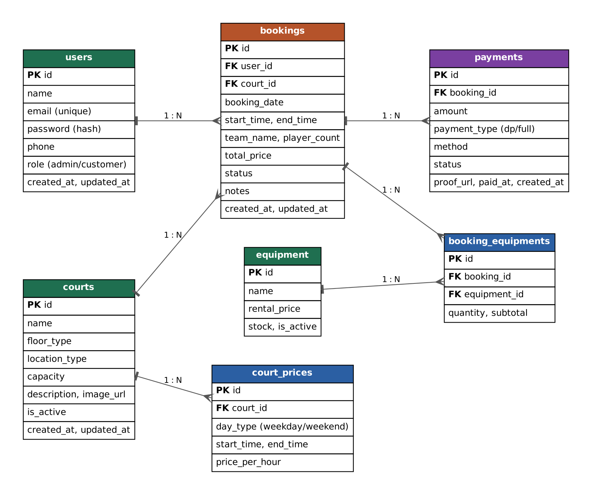

# FutsalKu API

REST API pemesanan lapangan futsal untuk satu venue dengan beberapa lapangan (Lapangan A, B, C) yang memiliki jenis lantai berbeda.

## Deskripsi
FutsalKu API memungkinkan penyewa melihat slot kosong, memesan lapangan, dan membayar (DP/lunas) secara online. Admin dapat mengelola lapangan, harga, perlengkapan, pembayaran, dan melihat laporan.

## Tujuan
- Penyewa bisa cek slot kosong dan booking tanpa telepon/WhatsApp.
- Mencegah double booking (bentrok jadwal).
- Admin mudah mengelola lapangan, harga, jadwal, dan pembayaran.

## Fitur
**Wajib**
- Register & login JWT, role-based access (admin / customer)
- CRUD lapangan dan harga dinamis (weekday/weekend, siang/malam) - admin
- Cek ketersediaan slot per lapangan per tanggal
- CRUD booking dengan validasi bentrok & hitung harga otomatis
- Pembayaran DP/lunas + verifikasi admin (booking otomatis `confirmed`)
- Pembatalan booking dengan batas waktu 3 jam

**Nilai plus (sudah ada)**
- Sewa perlengkapan (bola, rompi, sepatu) dengan cek stok per slot
- Auto-cancel booking pending yang tidak dibayar dalam 1 jam (`@nestjs/schedule`)
- Laporan admin: pendapatan per bulan, lapangan terlaris, jam tersibuk
- Filter & pagination, pencarian lapangan
- Seeder data awal

### Aturan bisnis
| Aturan | Nilai |
|---|---|
| Jam operasional | 08:00 - 23:00 |
| Jam booking | jam bulat (`19:00`, bukan `19:30`) |
| Durasi | min 1 jam, maks 3 jam |
| Tanggal | tidak boleh lampau; hari ini jam mulai harus > jam sekarang; maks 30 hari ke depan |
| Bentrok | `start < existing_end AND end > existing_start` (booking `cancelled` diabaikan) |
| Harga | jumlah harga tiap jam dari `court_prices` + sewa perlengkapan |
| DP | minimal 50% total; DP/lunas terverifikasi -> booking `confirmed` |
| Auto-cancel | pending tanpa pembayaran > 60 menit -> `cancelled` |
| Cancel customer | minimal 3 jam sebelum jam main (admin boleh kapan saja) |
| Lainnya | `playerCount` 1..kapasitas, lapangan nonaktif tidak bisa dibooking, stok perlengkapan dicek, maks 3 booking pending per customer |

Zona waktu venue: **WIB (UTC+7)**.

## Teknologi
NestJS 10, TypeORM, PostgreSQL (Supabase), JWT (passport-jwt), class-validator, Swagger (`@nestjs/swagger`), bcrypt (`bcryptjs`), `@nestjs/schedule`.

## ERD


File sumber: `docs/erd.dbml` (bisa ditempel ke [dbdiagram.io](https://dbdiagram.io)).

Relasi: `users 1:N bookings`, `courts 1:N bookings`, `courts 1:N court_prices`, `bookings 1:N payments` (DP lalu pelunasan), `bookings N:N equipment` (lewat `booking_equipments`).

## Cara Menjalankan
1. Clone repo lalu install dependensi
   ```bash
   git clone <url-repo-kamu>
   cd futsalku-api
   npm install
   ```
2. Buat project di [Supabase](https://supabase.com), lalu buka **Project Settings > Database > Connection string**. Salin host, port, user, password, database.
   > Jika koneksi direct (`db.xxxx.supabase.co`) gagal karena jaringan IPv4, gunakan **Session pooler** (host `aws-0-xxx.pooler.supabase.com`, user `postgres.<project-ref>`).
3. Salin env dan isi
   ```bash
   cp .env.example .env
   ```
   Isi `DB_HOST`, `DB_USERNAME`, `DB_PASSWORD`, `DB_NAME` (biasanya `postgres`), dan `JWT_SECRET` (string acak panjang).
4. (Opsional tapi disarankan) isi data awal
   ```bash
   npm run seed
   ```
5. Jalankan
   ```bash
   npm run start:dev
   ```
6. Buka Swagger: http://localhost:3000/api/docs

Tabel dibuat otomatis oleh TypeORM (`DB_SYNCHRONIZE=true`). Untuk produksi, set `false` dan gunakan migration.

### Akun seeder
| Role | Email | Password |
|---|---|---|
| admin | admin@futsalku.com | Admin123! |
| customer | budi@mail.com | Customer123! |
| customer | siti@mail.com | Customer123! |

Seeder juga membuat: Lapangan A (vinyl, indoor), B (interlock, indoor), C (sintetis, outdoor) dengan harga weekday siang/malam & weekend, serta perlengkapan Bola, Rompi, Sepatu.

### Cara memakai token di Swagger
Login lewat `POST /auth/login`, salin `accessToken`, klik tombol **Authorize** di kanan atas Swagger, tempel tokennya.

## Daftar Endpoint
| Modul | Method | Endpoint | Akses |
|---|---|---|---|
| Auth | POST | `/auth/register` | Public |
| Auth | POST | `/auth/login` | Public |
| Auth | GET | `/auth/profile` | Login |
| Users | GET | `/users` | Admin |
| Users | GET / PATCH / DELETE | `/users/:id` | Admin / pemilik |
| Courts | GET | `/courts` (filter: `floor_type`, `location_type`, `search`, `is_active`, `page`, `limit`) | Public |
| Courts | GET | `/courts/:id` | Public |
| Courts | GET | `/courts/:id/availability?date=2026-11-25` | Public |
| Courts | POST | `/courts` | Admin |
| Courts | PATCH / DELETE | `/courts/:id` | Admin |
| Court Prices | GET | `/courts/:id/prices` | Public |
| Court Prices | POST | `/courts/:id/prices` | Admin |
| Court Prices | PATCH / DELETE | `/court-prices/:id` | Admin |
| Equipment | GET | `/equipment` | Public |
| Equipment | POST | `/equipment` | Admin |
| Equipment | PATCH / DELETE | `/equipment/:id` | Admin |
| Bookings | POST | `/bookings` | Login |
| Bookings | GET | `/bookings` (filter: `status`, `date`, `court_id`, `page`, `limit`) | Admin: semua, customer: milik sendiri |
| Bookings | GET | `/bookings/:id` | Pemilik / admin |
| Bookings | PATCH | `/bookings/:id` (teamName, notes) | Pemilik / admin |
| Bookings | PATCH | `/bookings/:id/cancel` | Pemilik / admin |
| Bookings | PATCH | `/bookings/:id/status` (`no_show` / `completed`) | Admin |
| Bookings | DELETE | `/bookings/:id` | Admin |
| Payments | POST | `/bookings/:id/payments` | Login (pemilik / admin) |
| Payments | GET | `/payments`, `/payments/:id` | Pemilik / admin |
| Payments | PATCH | `/payments/:id/verify` | Admin |
| Payments | PATCH | `/payments/:id/refund` | Admin |
| Reports | GET | `/reports/revenue?month=2026-11` | Admin |

### Contoh body
Create booking:
```json
{
  "courtId": 1,
  "bookingDate": "2026-11-25",
  "startTime": "19:00",
  "endTime": "21:00",
  "teamName": "FC Brantas",
  "playerCount": 10,
  "equipments": [{ "equipmentId": 1, "quantity": 2 }]
}
```
Bayar DP:
```json
{ "amount": 130000, "paymentType": "dp", "method": "transfer", "proofUrl": "https://example.com/bukti.jpg" }
```

### Alur pembayaran
1. Customer membuat booking -> status `pending`.
2. Customer `POST /bookings/:id/payments` (DP >= 50% atau lunas) -> pembayaran berstatus `unpaid` (menunggu verifikasi).
3. Admin `PATCH /payments/:id/verify` -> pembayaran jadi `partial` (DP) / `paid` (lunas) dan booking otomatis `confirmed`.
4. Pelunasan: customer kirim pembayaran `full` sebesar sisa tagihan, lalu diverifikasi admin.
5. Pembayaran yang dibuat oleh admin (mis. tunai di tempat) langsung terverifikasi.

### Format error (konsisten)
```json
{ "statusCode": 409, "message": "Jadwal sudah dipesan", "error": "Conflict", "timestamp": "2026-11-20T03:00:00.000Z" }
```

## Skenario Pengujian Swagger (untuk screenshot)
Simpan screenshot ke `docs/swagger-screenshots/`.

| No | Skenario | Hasil |
|---|---|---|
| 1 | Register dan login | 201 / 200 |
| 2 | Register email duplikat | 409 |
| 3 | Akses endpoint admin dengan token customer | 403 |
| 4 | Akses tanpa token | 401 |
| 5 | Admin tambah lapangan dan harga | 201 |
| 6 | Cek availability | 200 |
| 7 | Booking sukses | 201 |
| 8 | Booking di slot yang sudah terisi | 409 |
| 9 | endTime lebih kecil dari startTime | 400 |
| 10 | Booking di tanggal lampau | 400 |
| 11 | Booking durasi lebih dari 3 jam | 400 |
| 12 | Booking di lapangan nonaktif | 400 |
| 13 | Bayar DP + verifikasi admin, booking jadi confirmed | 201 / 200 |
| 14 | Cancel kurang dari 3 jam sebelum main | 400 |
| 15 | Booking ID tidak ditemukan | 404 |

Tips: untuk skenario 14, buat booking di hari ini dengan jam mulai < 3 jam lagi (pakai token customer), lalu panggil `cancel`.
Untuk skenario 12, nonaktifkan lapangan dengan `PATCH /courts/:id` body `{ "isActive": false }`.

## Screenshot Swagger
(Tempel screenshot dari `docs/swagger-screenshots/` di sini)

## Struktur Folder
```
src/
├── auth/         # register, login, JWT strategy
├── users/
├── courts/       # courts + court_prices + availability
├── equipment/
├── bookings/     # logika bentrok, harga, cancel, scheduler
├── payments/
├── reports/
├── common/       # filters, guards, decorators, utils, dto
├── config/       # konfigurasi TypeORM & daftar entity
├── database/     # seed.ts
├── app.module.ts
└── main.ts
docs/
├── erd.png
├── erd.dbml
└── swagger-screenshots/
```

## Identitas Pembuat
- Nama  : _isi nama kamu_
- NIM   : _isi NIM_
- Kelas : _isi kelas_
